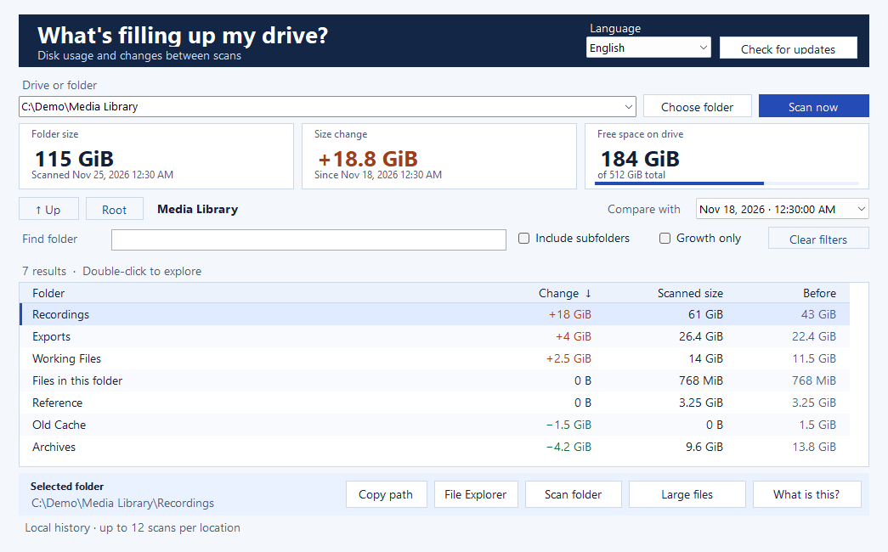
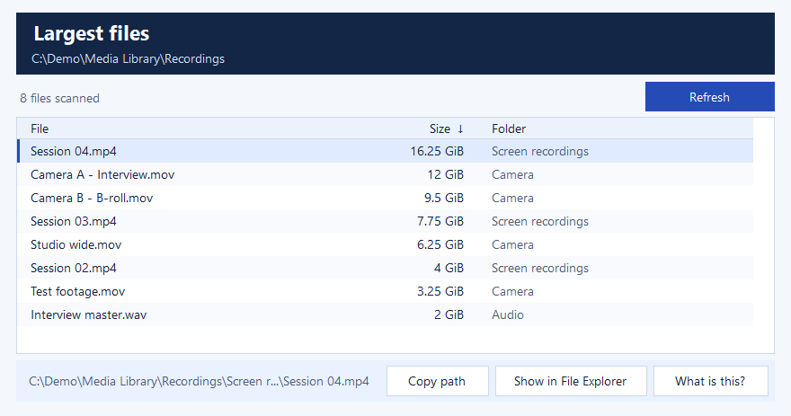
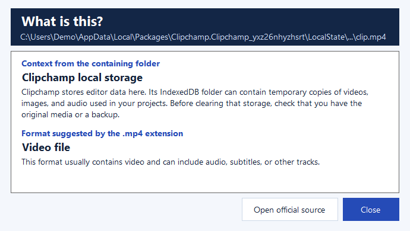
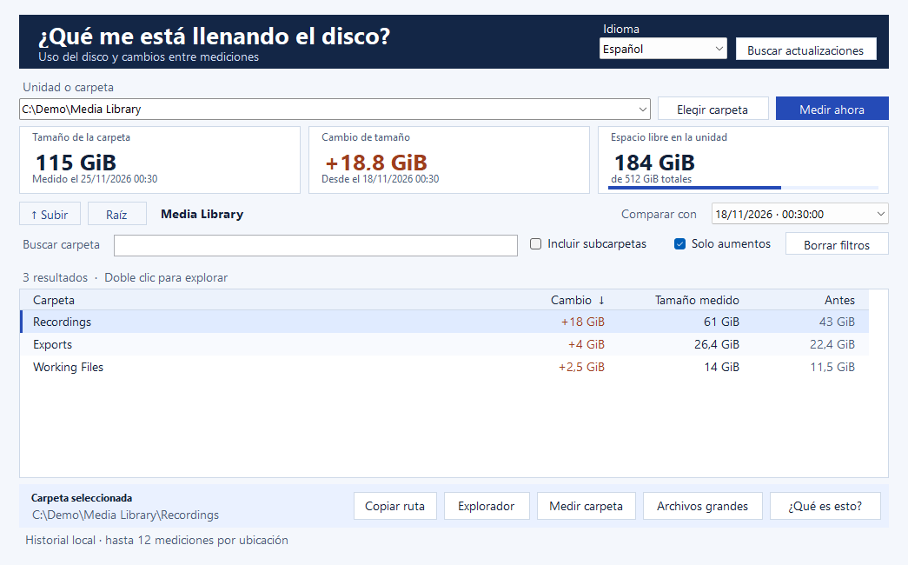

# Disk Growth Tracker

[](https://github.com/ZielCL/Disk-Growth-Tracker/raw/refs/heads/main/downloads/Disk%20Growth%20Tracker%201.6.0.exe)
[](https://github.com/ZielCL/Disk-Growth-Tracker#how-it-works)
[](https://github.com/ZielCL/Disk-Growth-Tracker/actions/workflows/windows-build.yml)
[](https://github.com/ZielCL/Disk-Growth-Tracker#guía-en-español)
[](https://github.com/ZielCL/Disk-Growth-Tracker/stargazers)
[](https://github.com/ZielCL/Disk-Growth-Tracker/issues/new)

**Find what grew since the last time you checked your disk.**

Disk Growth Tracker is a portable Windows 11 app that compares folder sizes across scans. When free space drops, you can see which folders account for the change and inspect the largest files inside them.

**[Download v1.6.0 for Windows](https://github.com/ZielCL/Disk-Growth-Tracker/raw/refs/heads/main/downloads/Disk%20Growth%20Tracker%201.6.0.exe)** · [How it works](#how-it-works) · [Guía en español](#guía-en-español) · [Build from source](#build-from-source)



*Example with demo data. Media Library grew by **18.8 GiB** in a week, with **Recordings** accounting for the largest increase.*

## How it works

1. **Save a baseline.** Open the executable, choose a drive or folder, and select **Scan now**.
2. **Scan the same location again.** The app compares the new scan with the previous one by default. Use **Compare with** to select an older scan.
3. **Follow the largest changes.** Turn on **Growth only** to focus on increases, or **Include subfolders** to rank deeper folders in one list. Double-click a folder to explore it.
4. **Inspect the files.** Select a folder and open **Large files**. The list shows up to 100 of the largest files currently in that folder and its subfolders. Select a file to copy its full path or show it in File Explorer.



### What the measurements mean

| In the app | What it tells you |
| --- | --- |
| **Change** | The difference in measured folder size between the two selected scans. |
| **Large files** | The current size and location of each file in the list. |
| **Free space on drive** | The latest available-space reading for the drive. |
| **≈** | At least one relevant entry was inaccessible or could not be measured. |

The scanner sums logical file sizes and skips reparse points such as junctions. Scans read file metadata. The app stores up to 12 scans per location and saves the language preference locally in `%LOCALAPPDATA%\CrecimientoDisco`.

## What is this?

Select a folder, or select a file in **Large files**, and choose **What is this?**. The app explains recognized paths such as Clipchamp storage, Steam libraries, or Windows Installer. For common file extensions it suggests a format. A file can have both a folder explanation and a separate format explanation.



## Update the app

Starting with v1.6.0, select **Check for updates** next to the language picker. If a newer version is available, the app asks before downloading it. It verifies the file against the published SHA-256 checksum and restarts using the new version. The portable executable needs to be in a folder you can write to.

If you use an earlier version, download v1.6.0 once using the button above.

## Guía en español

Elige **Español** en el selector de idioma. Selecciona una unidad o carpeta y pulsa **Medir ahora**. Mide la misma ubicación más adelante y activa **Solo aumentos** para ver qué creció. Usa **Archivos grandes** para revisar los archivos que más pesan. El botón **¿Qué es esto?** explica rutas conocidas y formatos comunes. Para instalar una nueva versión, pulsa **Buscar actualizaciones**.

<details>
<summary>Ver la interfaz en español</summary>



</details>

## Build from source

The app uses C# and Windows Forms on .NET Framework. Run the build script on Windows from the repository root.

```powershell
.\build.ps1
```

The executable will be at `artifacts\Disk Growth Tracker.exe`. Add `-RunChecks` to build and run the checks with temporary sample folders.

```powershell
.\build.ps1 -RunChecks
```

### Prepare a stable update

Bump `AssemblyVersion` in `src/DiskApp.cs` as `major.minor.patch.0` and build the release files.

```powershell
.\build.ps1 -RunChecks -PrepareUpdate
```

Copy the new executable and `updates/stable.txt` from `artifacts/release` into the corresponding repository folders. Commit the executable, manifest, and source together. Update the README download links to the new version.

To report a problem, include your Windows version, the app version, and steps to reproduce it. [Open an issue](https://github.com/ZielCL/Disk-Growth-Tracker/issues/new).
